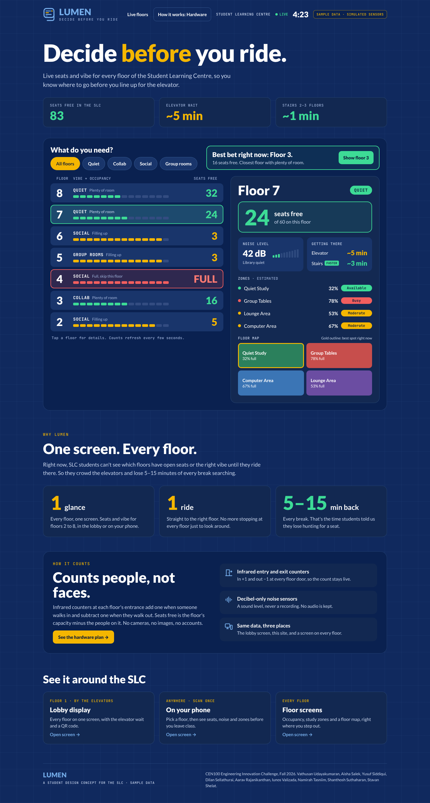

# LUMEN

**Decide before you ride.** LUMEN shows live seat availability and noise ("vibe") for every floor of TMU's
Student Learning Centre (SLC), so students know where to go before they line up for the elevator.

A student engineering project for CEN100, Fall 2026. This repository is the real, runnable website and
backend. It runs today on simulated sensors and switches to real ESP32 sensor data by setting one
environment variable.



## What it does

- **Seats free per floor.** Two-beam laser gates at each way onto a floor count people in and out.
  Seats free = floor capacity minus the people on it.
- **Noise per floor.** Decibel-only microphones report one loudness number (Leq) every 10 s. No audio is kept.
- **The same data in four places:** the website (`/`), a phone view (`/phone`), the elevator lobby screen
  (`/lobby`) and a screen on each floor (`/floor/7`). There is also a hardware explainer (`/hardware`).
- **Honest about gaps.** If a floor stops reporting for 2 minutes, every screen greys it out and says
  "Last updated N min ago". Zone percentages are estimates (door counters cannot see zones) and are
  marked `estimated: true` in the API and "estimated" on screen. While `SIMULATE=1` is on, every screen
  shows a SAMPLE DATA badge.

## Architecture

```
 ESP32 gate nodes (2 lasers per door)  ─┐
 ESP32 noise nodes (INMP441 mic)       ─┤  Bluetooth LE adverts, 1 per second
                                        ▼
                               ESP32 floor hub (one per floor)
                                        │  Wi-Fi, MQTT (TLS in production)
                                        ▼
                                  MQTT broker (e.g. Mosquitto)
                                        │  lumen/slc/#
                                        ▼
            LUMEN server (Node 22 + TypeScript + Express)  ── SQLite: 1 snapshot per floor per minute
                 │ REST: /api/floors, /api/floors/:n, /api/health
                 │ Server-Sent Events: /api/stream
                 ▼
     Web app (Vite + React)  ──  website, phone view, lobby kiosk, floor kiosks
```

```
lumen-site/
├── server/                 Node 22 + TypeScript backend
│   ├── config/floors.json  floors 2 to 8: capacity, vibe, zones, gate + mic node IDs
│   ├── scripts/            export-snapshots.mjs (SQLite snapshots -> CSV for MATLAB)
│   ├── src/occupancy.ts    counting logic (running totals, baselines, reboots, staleness, noise median)
│   ├── src/store.ts        live state per floor, API views
│   ├── src/ingest.ts       MQTT topic + payload parsing
│   ├── src/mqtt.ts         broker connection (mqtt.js)
│   ├── src/simulator.ts    SIMULATE=1 fake nodes
│   ├── src/api.ts          REST, SSE, serves the built web app
│   ├── src/persistence.ts  saved gate baselines (JSON) + optional SQLite history
│   └── test/               Vitest
├── matlab/                 MATLAB analytics & plotting pipeline for both peak-hour graphs
│   ├── run_lumen_peak_hours.m      entrypoint: compute datasets, export JSON & plot both graphs
│   ├── load_lumen_snapshots.m      reads server/data/lumen.db (SQLite) or CSV logs
│   ├── compute_peak_hours.m        hourly occupancy, energetic Leq, movmean trends, R^2 regression
│   ├── export_peak_hours_json.m    writes web/src/data/peakHours.json
│   ├── plot_peak_hours_graphs.m    plots Foot Traffic + Noise MATLAB figures to matlab/output/
│   └── sample_snapshots.csv        5-weekday sample snapshot log (2,439 rows)
├── web/                    Vite + React + TypeScript + React Router
│   ├── src/components/     floor plan, peak-hour charts, QR code, kiosk frame
│   ├── src/data/           MATLAB-generated typical-weekday data (peakHours.json)
│   ├── src/pages/          Home, hardware/, Lobby, FloorScreen, Phone
│   ├── src/lib/            logic (recommendation rule etc.), peak-hour helpers, live data hook
│   └── test/
└── screenshots/
```

## Run it

Needs Node.js 22.12 or newer.

```bash
npm install
npm run dev      # server with SIMULATE=1 on :8080, plus Vite on :5173 with an /api proxy
```

Open http://localhost:5173. Kiosk views: http://localhost:5173/lobby and http://localhost:5173/floor/7.

| Script | What it does |
| --- | --- |
| `npm run dev` | Server (simulated sensors, auto-restart) and Vite dev server together |
| `npm run build` | Type-checks and builds `web/dist` and `server/dist` |
| `npm test` | Vitest for the server and the web logic |
| `npm start` | Production: the server serves the API and the built web app on one port |
| `npm run start:sim` | Same as `npm start` with `SIMULATE=1` |
| `npm run export:snapshots` | Export SQLite `snapshots` table to `matlab/snapshots.csv` for MATLAB |

Production with simulated data:

```bash
npm run build
SIMULATE=1 npm start          # http://localhost:8080
```

## Environment variables

All optional.

| Variable | Default | Meaning |
| --- | --- | --- |
| `PORT` | `8080` | HTTP port |
| `HOST` | `0.0.0.0` | HTTP bind address |
| `SIMULATE` | off | `1` runs fake gate, noise and hub nodes in-process |
| `MQTT_URL` | none | e.g. `mqtt://192.168.1.20:1883` or `mqtts://broker.example:8883`. Turns on MQTT ingest |
| `MQTT_USERNAME`, `MQTT_PASSWORD` | none | Broker credentials |
| `MQTT_CLIENT_ID` | random | Client ID for the server |
| `FLOORS_CONFIG` | `server/config/floors.json` | Path to the floors file |
| `PUBLIC_URL` | the page's own address | Home URL in the lobby QR code. Set it to an address phones can reach |
| `STALE_AFTER_S` | `120` | Seconds of silence before a floor is shown as stale |
| `RESET_HOUR` | `3` | Hour of the nightly reset (0 to 23) |
| `RESET_TZ` | `America/Toronto` | Time zone for the nightly reset and the `updated` field |
| `ELEVATOR_WAIT_MIN` | `6` | Elevator wait estimate. It is a configured estimate, not a measurement |
| `STATE_PATH` | `server/data/state.json` (off when simulating) | Saved gate baselines, so a server restart keeps the count |
| `DB_PATH` | `server/data/lumen.db` (`lumen-sim.db` when simulating) | SQLite history file |
| `NO_DB` | off | `1` turns history off |
| `WEB_DIST` | `web/dist` | Built web app to serve |
| `SIM_SILENT_FLOORS` | none | e.g. `2` makes floor 2's fake hub go quiet, to demo stale screens |
| `SIM_SILENT_AFTER_S` | `30` | When the silent floors stop talking |

SQLite history uses `better-sqlite3` if it installed (it is an optional dependency), otherwise Node's built-in
`node:sqlite`, otherwise it is skipped with a log line. Nothing else depends on it.

## How the counting works

Gate nodes send **running totals** (`in_total`, `out_total` since the node booted), never "+1". A missed
message is fixed by the next one. The server keeps, per gate, the totals at the last nightly reset (the
baseline):

```
on_floor   = max(0, sum over the floor's gates of (in_total - out_total) - baseline)
seats_free = max(0, capacity - on_floor)
noise_db   = median of the floor's mics' latest leq_db
```

- **Duplicates and out-of-order messages** are ignored using the 16-bit `seq` (wraparound handled).
- **Node reboot:** if a gate's totals go down, the node restarted from zero. The people counted so far are
  carried over and that gate is re-baselined at zero.
- **Nightly reset** at `RESET_HOUR` in `RESET_TZ` (default 03:00 Toronto time) sets every baseline to the current
  totals, so small misses never pile up. Baselines are saved to `STATE_PATH`.
- **Stale:** a floor with no message or heartbeat for 2 minutes, or whose hub's MQTT last will says
  `offline`, is `stale: true`. Its last numbers are kept and labelled.
- **Zones** are configured estimates scaled by floor occupancy (`estimated: true`). A full floor shows every zone full.
- **Recommendation** (web): the closest floor (lowest number) with at least 15 free seats, otherwise the
  matching floor with the most free seats. Stale floors are never recommended.

## Peak hours data (MATLAB pipeline)

`web/src/data/peakHours.json` holds typical-weekday hourly foot traffic and noise levels from 7 AM to 11 PM for floors 2 to 8, plus 3-hour moving-average trends and occupancy-vs-noise regression stats. It powers both charts under the floor detail view on `/` and `/phone`, and is clearly labelled on screen as `"Typical weekday · sample (MATLAB)"` (or `"Typical weekday · MATLAB measured"` once live logs are processed).

The `matlab/` pipeline ([`matlab/run_lumen_peak_hours.m`](matlab/run_lumen_peak_hours.m)) computes both datasets from snapshot logs (`server/data/lumen.db`, `matlab/snapshots.csv`, or the 5-weekday `matlab/sample_snapshots.csv`), generates **both MATLAB graphs** (Foot Traffic by Hour + Noise by Hour) in `matlab/output/`, and exports `web/src/data/peakHours.json`:

```matlab
run('matlab/run_lumen_peak_hours.m')
```

- **Graph 1 (Foot traffic):** weekday mean occupancy clamped to `[0, capacity]`, seat-availability color bars, capacity reference line, and 3-hour `movmean(..., 3)` trend.
- **Graph 2 (Noise):** energetic equivalent sound level $L_{\text{eq}} = 10 \log_{10}(\text{mean}(10^{\text{dB}/10}))$ across `Quiet` (`<45 dB`), `Low chatter` (`45–60 dB`), and `Social` (`>60 dB`) bands, `movmean(..., 3)` trend, and traffic–noise linear regression ($R^2$, slope via `corrcoef` / `polyfit`).

To export live SQLite snapshots to CSV for MATLAB Online or installs without Database Toolbox, run `npm run export:snapshots` before running `matlab/run_lumen_peak_hours.m`.

```json
{
  "source": "sample",
  "description": "Typical weekday, sample sensor snapshot averages computed via MATLAB",
  "pipeline": {
    "engine": "MATLAB",
    "script": "matlab/run_lumen_peak_hours.m",
    "timezone": "America/Toronto",
    "sample_count": 2380
  },
  "hours": [7, 8, 9, 10, 11, 12, 13, 14, 15, 16, 17, 18, 19, 20, 21, 22, 23],
  "floors": {
    "7": {
      "people": [3, 11, 22, ...],
      "noise_db": [34.4, 36.1, 38.2, ...],
      "matlab": { "trend_people": [...], "trend_noise_db": [...], "traffic_noise_r2": 0.991 }
    }
  }
}
```

Each floor entry has 17 whole-number occupancy values (`people`), 17 one-decimal energetic $L_{\text{eq}}$ decibel values (`noise_db`), and the MATLAB `movmean`/regression summary matching the 17 hours in `hours`.

## MQTT reference

Topics use the site code from `floors.json` (`slc`). The server subscribes to `lumen/slc/#`.

**Gate node**, `lumen/slc/f{n}/gate/{name}` (e.g. `lumen/slc/f7/gate/elevator`):

```json
{ "node": "f7-gate-elevator", "seq": 18342, "in_total": 1240, "out_total": 1202, "flags": [], "rssi": -61 }
```

**Noise node**, `lumen/slc/f{n}/noise/{name}` (e.g. `lumen/slc/f7/noise/quiet-side`):

```json
{ "node": "f7-mic-quiet", "seq": 5521, "leq_db": 42.3, "peak_db": 55.1, "window_s": 60 }
```

**Floor hub heartbeat**, `lumen/slc/f{n}/hub/status`: `online` (or `{"status":"online", ...}`) every 30 s.
Hubs should set their MQTT last will on this topic to `offline`; the server then greys out that floor at once.

The `node` IDs must be listed under that floor's `gates` or `mics` in `server/config/floors.json`; anything
else is logged once and ignored. The server announces itself on `lumen/slc/server/status` (retained `online`,
last will `offline`).

## API reference

| Endpoint | Returns |
| --- | --- |
| `GET /api/floors` | `{ site, simulated, public_url, server_time, stale_after_s, elevator_wait_min, elevator_wait_estimated, floors: [...] }`, floors 8 to 2 |
| `GET /api/floors/:n` | One floor (below). Add `?nodes=1` for per-node totals, seq, flags and last seen |
| `GET /api/stream` | Server-Sent Events: `event: floors` with the same body as `/api/floors` on every change (at most 2 per second, and at least every 30 s), plus `: heartbeat` comments every 15 s |
| `GET /api/health` | Uptime, MQTT status, message counters, stale floors, history engine |

```json
{
  "floor": 7, "vibe": "Quiet", "capacity": 60, "on_floor": 38, "seats_free": 22, "noise_db": 42,
  "updated": "11:42:07", "updated_at": "2026-11-18T16:42:07.000Z", "age_s": 3,
  "stale": false, "stale_reason": null,
  "zones": [{ "name": "Quiet Study", "pct": 34, "estimated": true }],
  "elevator_wait_min": 6, "faults": []
}
```

## Pointing it at a real broker

1. Run a broker the hubs can reach. For the class demo, Mosquitto on a laptop on the same phone hotspot:
   `mosquitto -p 1883` (add a password file and TLS before anything leaves the bench).
2. List every node ID in `server/config/floors.json` (capacity, vibe, `gates`, `mics` per floor).
3. Start the server:

   ```bash
   npm run build
   MQTT_URL=mqtt://192.168.43.10:1883 PUBLIC_URL=http://192.168.43.10:8080/ npm start
   ```

4. Check it: `curl localhost:8080/api/health` shows `"mqtt": {"connected": true, ...}` and message counts.
   To test without hardware, publish a message by hand:

   ```bash
   mosquitto_pub -h 192.168.43.10 -t lumen/slc/f7/gate/elevator \
     -m '{"node":"f7-gate-elevator","seq":1,"in_total":40,"out_total":2,"flags":[],"rssi":-60}'
   ```

`SIMULATE=1` together with `MQTT_URL` makes the fake nodes publish through the broker instead of in-process,
which is a quick end-to-end test of a broker.

## Raspberry Pi kiosks

Each lobby or floor screen is a TV with a Raspberry Pi running Chromium full screen. One server update
reaches every screen.

1. Raspberry Pi OS with desktop. Set the Pi to log in automatically and turn off screen blanking
   (`sudo raspi-config` → Display Options → Screen Blanking → No).
2. Lobby screen (portrait TV): rotate the display in Screen Configuration, then open `/lobby`. The design is
   540 × 960 and scales to fill any portrait screen, with letterbox bars if the ratio differs.
3. Floor screen (landscape TV): open `/floor/7` (use the floor's own number). The design is 1280 × 720 and scales to fit.
4. Start Chromium in kiosk mode on boot. Create `~/.config/autostart/lumen.desktop`:

   ```ini
   [Desktop Entry]
   Type=Application
   Name=LUMEN kiosk
   Exec=chromium-browser --kiosk --noerrdialogs --disable-infobars --incognito --check-for-update-interval=31536000 --autoplay-policy=no-user-gesture-required http://lumen-server.local:8080/lobby
   ```

   For a floor screen use `http://lumen-server.local:8080/floor/7`. On newer Raspberry Pi OS the binary is `chromium`.
5. Optional: `sudo apt install unclutter` and add `unclutter -idle 1 &` to hide the mouse pointer.

The screens reconnect on their own (Server-Sent Events with automatic retry, and REST polling while the stream is
down). If the server itself is unreachable, floors grey out after 2 minutes and show when they last updated.

## Accessibility and privacy

- Colour is never the only signal: numbers and words (FULL, Busy, Moderate, NO SIGNAL) are always shown.
- Real buttons and links, 44 px touch targets, a visible gold focus ring, 4.5:1 text contrast (two floor-map
  tile colours are a shade darker than the prototype for this), and `prefers-reduced-motion` is respected.
- No cameras, no audio kept, no phone scanning, no accounts, no cookies, no analytics. The API only ever holds
  counts and decibel levels.

## Tests

`npm test` runs Vitest: occupancy from running totals (duplicates, out-of-order `seq`, wraparound, node reboot,
nightly reset, clamp at 0), stale detection (silence, heartbeats, hub last will), the noise median, nightly reset
timing across daylight saving, the simulator, MQTT end to end through an in-process broker (Aedes), and the
recommendation rule and display helpers in the web app.

## Team

CEN100 Engineering Innovation Challenge, Fall 2026. Vathusan Udayakumaran, Aisha Salek, Yusuf Siddiqui,
Dilan Sellathurai, Aarav Rajanikanthan, Iunos Valizada, Namirah Tasniim, Shanthosh Suthaharan, Stavan Shelat.
